# Лабораторная работа: Продакшн-образы Docker
---
## Среда
---
- **ОС:** Windows 11
- **Docker Desktop:** 4.92.0
- **Docker Client/Engine:** 29.8.0
- **Терминал:** Git Bash
- **Docker Hub логин:** `bibimka`
## Задания
---
## Dockerfile (multi-stage)
```dockerfile
FROM python:3.12-slim AS builder

WORKDIR /build
COPY requirements.txt .
RUN pip install --no-cache-dir --prefix=/install -r requirements.txt

FROM python:3.12-slim

ARG LAB_LOGIN=unknown
ARG LAB_TOKEN=unknown

LABEL org.lab.login="$LAB_LOGIN" \
      org.lab.token="$LAB_TOKEN" \
      org.opencontainers.image.title="image-lab"

ENV PYTHONDONTWRITEBYTECODE=1 \
    PYTHONUNBUFFERED=1 \
    ROCKET_SIZE=Small \
    PORT=8000 \
    LAB_LOGIN=$LAB_LOGIN \
    LAB_TOKEN=$LAB_TOKEN

WORKDIR /opt/app
COPY --from=builder /install /usr/local
COPY app/ ./app/

RUN useradd --create-home --shell /bin/bash appuser \
    && chown -R appuser:appuser /opt/app
USER appuser

HEALTHCHECK --interval=30s --timeout=3s --start-period=5s --retries=3 \
    CMD python -c "import urllib.request,sys; sys.exit(0 if urllib.request.urlopen('http://127.0.0.1:8000/health').status==200 else 1)"

EXPOSE 8000

VOLUME ["/tmp"]
ENTRYPOINT ["gunicorn", "--bind", "0.0.0.0:8000", "--workers", "1", "--threads", "4", "app.app:app"]
```

**Пояснения к командам:**
- FROM: Задаёт базовый образ, с которого начинается сборка.
- WORKDIR: Создаёт директорию (если её нет) и делает её текущей рабочей папкой для всех последующих инструкций (`RUN`, `COPY`, `CMD` и т.д.).
- COPY: Копирует файлы или папки с компьютера (из контекста сборки) внутрь образа.
- RUN: Выполняет команду внутри контейнера во время сборки образа (создаёт новый слой).
- ARG: Объявляет переменную, которую можно передать только на этапе сборки (через `--build-arg`). В готовом контейнере этой переменной уже не будет, если её не перенести в `ENV`.
- LABEL: Добавляет метаданные (ключ-значение) к образу.
- ENV: Задаёт переменные окружения, которые будут доступны приложению во время работы контейнера.
- USER: Переключает пользователя, от имени которого будут запускаться все последующие команды (`RUN`, `CMD`, `ENTRYPOINT`) и сам контейнер.
- HEALTHCHECK: Периодически запускает команду внутри контейнера, чтобы проверить, «жив» ли сервис.
- EXPOSE: Это документация для человека. Она сообщает, что приложение внутри слушает порт 8000.
- VOLUME: Объявляет точку монтирования. Данные в этой папке не будут сохраняться в слое контейнера, а будут храниться в специальной области на хосте (или в оперативной памяти).
- ENTRYPOINT: Задаёт главный процесс контейнера (PID 1). Именно он запускается при старте.
## Результаты проверки
- **Размер образа:** < 150 MB (см. вывод `docker images`)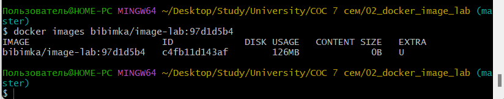
  126 MB
- **HEALTHCHECK:** статус `(healthy)` в `docker ps`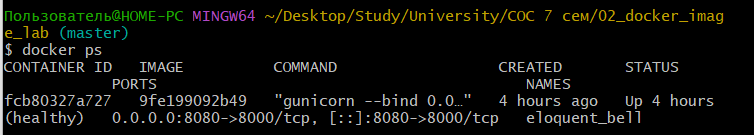
- **Non-root:** `whoami` → `appuser`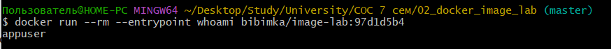
- **SIGTERM:** код выхода `0`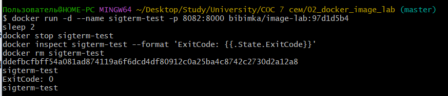
  Контейнер завершился с кодом 0 (корректно обработал SIGTERM).
- **`--read-only`:** контейнер работает, `/health` отвечает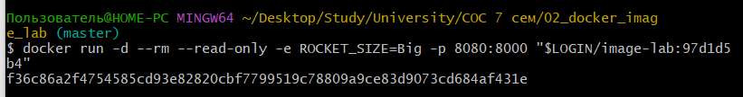
  Проверка эндпоинтов через `curl`: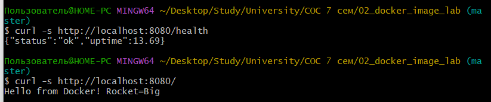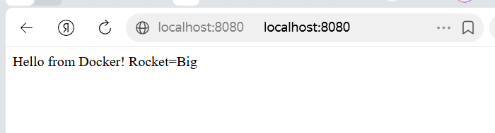
- **`ROCKET_SIZE`:** ответ `Rocket=Big` при `-e ROCKET_SIZE=Big`
## Вывод `docker history`
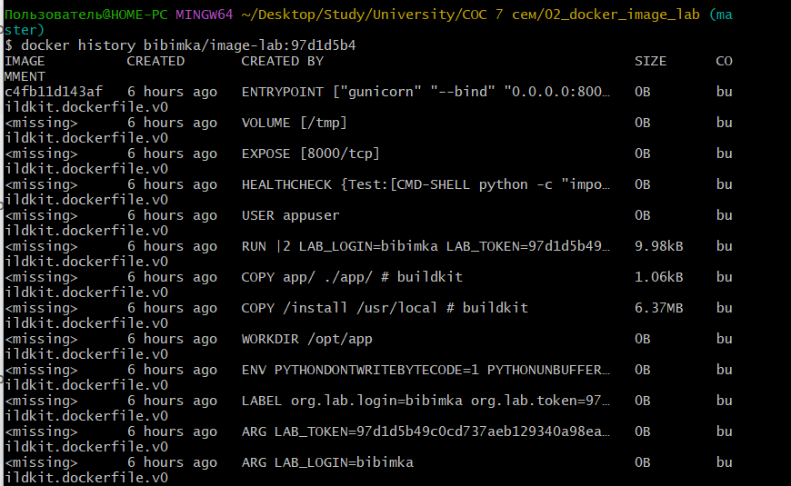 Видно, что финальный образ состоит из легковесных слоев, а зависимости (6.37MB) скопированы отдельно из builder-стадии.
## Чем образ лучше «наивной» сборки
Образ собран с использованием multi-stage сборки. В первом этапе (builder) устанавливаются зависимости, а во второй (финальный) копируются только готовые библиотеки из папки `/install`. Это позволило избавиться от кэша pip, временных файлов и компиляторов, благодаря чему итоговый размер образа составляет 126 MB (вместо ~1 ГБ у «наивной» сборки на базе python:3.12). Зависимости копируются отдельно от исходного кода — при изменении только `app.py` слой с pip-пакетами берётся из кэша, что ускоряет пересборку. Приложение запускается под специально созданным пользователем `appuser`, а не под root, что повышает безопасность. `ENTRYPOINT` задан в exec-форме (`gunicorn ...`), поэтому SIGTERM передаётся напрямую процессу, обеспечивая корректное завершение. Благодаря `PYTHONDONTWRITEBYTECODE=1` и объявлению `VOLUME ["/tmp"]`, контейнер успешно работает с флагом `--read-only`. Переменная окружения `ROCKET_SIZE` передаётся при запуске через `-e`, позволяя менять поведение приложения без пересборки. Также добавлен `HEALTHCHECK`, который автоматически проверяет доступность эндпоинта `/health`.
## Ссылка на Docker Hub
- Образ: `bibimka/image-lab:97d1d5b4`
- Репозиторий: https://hub.docker.com/r/bibimka/image-lab/tags

---
## Доп. материалы
Dockerfile "наивной" сборки:
```GitBash
FROM python:3.12

WORKDIR /app

COPY requirements.txt .
COPY app/ ./app/

RUN pip install -r requirements.txt

EXPOSE 8000
ENTRYPOINT ["gunicorn", "--bind", "0.0.0.0:8000", "app.app:app"]
```
Использовался полный базовый образ `python:3.12` (без `-slim`), зависимости устанавливались одной командой без флага `--no-cache-dir`, а исходный код копировался до установки пакетов.
Сборка образа:
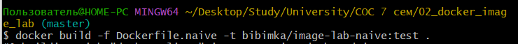
Сравнение образов:
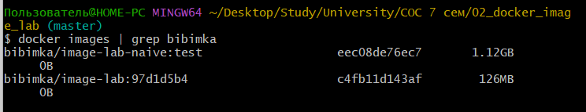

---
## Ответы на вопросы:
1. **В Dockerfile используется VOLUME ["/tmp"] для работы с --read-only. Объясните, чем это отличается от --tmpfs /tmp и где хранятся данные создаваемого тома.**  
   Эти два подхода решают одну задачу (дают приложению папку для записи при `--read-only`), но работают по-разному:
	- **`--tmpfs /tmp` (флаг при запуске):** Создает файловую систему в оперативной памяти (RAM). Данные живут только пока контейнер запущен. При остановке контейнера данные мгновенно исчезают. Этот флаг нужно указывать вручную при каждом запуске контейнера.
	- **`VOLUME ["/tmp"]` (инструкция в Dockerfile):** Указывает Docker'у, что эта папка должна быть вынесена за пределы read-only слоя. При запуске с `--read-only` Docker автоматически создает анонимный том (anonymous volume).
	**Где хранятся данные:** В отличие от `tmpfs`, данные тома хранятся на диске хоста (внутри виртуальной машины Docker Desktop по пути `/var/lib/docker/volumes/`). Они сохраняются при перезапуске или остановке контейнера. 
	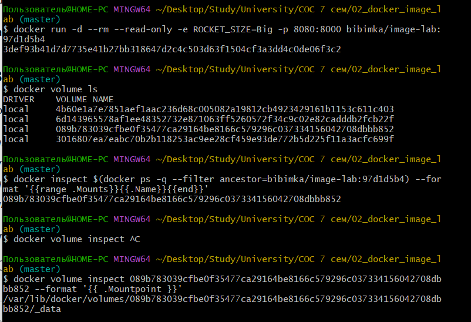
	На скриншоте в выводе последней команды видно, где хранится том (указан путь). 
	В тексте лабораторной работы была дана команда для запуска, поэтому флаг `--tmpfs /tmp` я не использовала (чтобы не менять команду), а Dockerfile по заданию нужно было написать свой, и там я добавила `VOLUME` для работы с `--read-only`.
	
2. **В отчете указано, что multi-stage позволяет исключить компиляторы, хотя в вашей сборке они отдельно не устанавливаются. Объясните, за счет чего именно уменьшается размер итогового образа.**
   Хотя компиляторы (`gcc`, `make`) в данной сборке действительно не устанавливаются, размер уменьшается за счет изоляции «мусора» установки в builder-стадии:
		Изоляция файлов: зависимости ставятся с флагом `--prefix=/install`. В финальную стадию копируется только папка с готовыми библиотеками (`COPY --from=builder /install /usr/local`). Все временные файлы и скрипты установки остаются в builder-стадии и не попадают в итоговый образ.
		Отсутствие кэша пакетов: Благодаря флагу `--no-cache-dir` `pip` не сохраняет скачанные архивы `.whl`.
	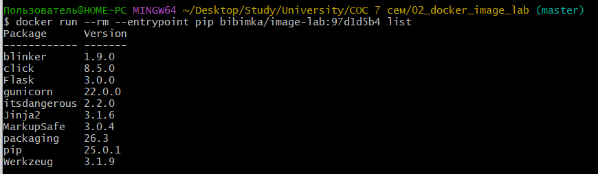
    Вывод: в образе находятся только 9 необходимых библиотек для работы приложения (Flask, gunicorn и их зависимости).
    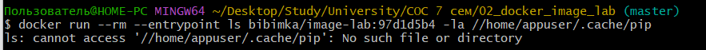
    Вывод: папки с кэшем пакетов не существует (`No such file or directory`), т.е. флаг `--no-cache-dir` работает. 
	(img_02/docker_history.png)
    Вывод: слой с зависимостями (`COPY /install`) весит всего 6.37MB, а финальный размер образа — 126 MB.
